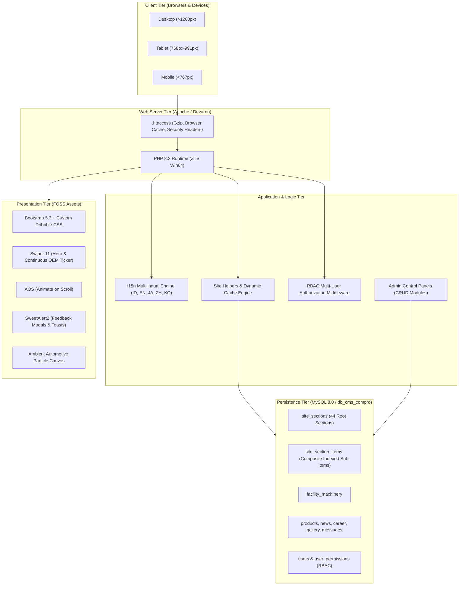

# 🏗️ System Architecture & Technical Specifications
## PT Nihon Plast Indonesia - Tier-1 Automotive CMS Portal

---

### 1. High-Level Architecture Overview

Aplikasi dibangun menggunakan arsitektur **Modular Multi-Tier Monolithic (PHP 8.3 Native + MySQL 8.0)** dengan fokus pada performa ekstrem, zero dependencies runtime berbayar, dan kemudahan pemeliharaan.



---

### 2. Layered Component Architecture

#### 2.1 Presentation Tier
* **Modular Includes**:
  * [`includes/head.php`](file:///C:/Devaron/www/cms-compro/includes/head.php): Meta viewport, Google Font *Plus Jakarta Sans*, Bootstrap 5.3 CSS, Vendor CSS (Swiper 11, SweetAlert2, AOS), dan `modern-dribbble.css`.
  * [`includes/navbar.php`](file:///C:/Devaron/www/cms-compro/includes/navbar.php): Micro utility topbar (`.site-topbar`) + primary navigation (`.site-navbar`) dengan aturan tegas `white-space: nowrap !important;`.
  * [`includes/footer.php`](file:///C:/Devaron/www/cms-compro/includes/footer.php): Footer korporat dengan kredensial IATF 16949, tautan navigasi, skrip vendor lokal, dan inisialisasi AOS & SweetAlert2.
* **Modern Automotive CSS Architecture**:
  * `assets/css/style.css`: Palet warna identitas korporat hijau emerald (`--np-green: #005A36`).
  * `assets/css/modern-dribbble.css`: Glassmorphic HUD cards (`backdrop-filter: blur(14px)`), Hero Swiper styling, slider progress bar, dan OEM linear marquee ticker.
* **High-Performance Lightweight JavaScript**:
  * `assets/js/ambient-canvas.js`: Kanvas partikel murni tanpa dependensi eksternal, dilengkapi `IntersectionObserver` agar otomatis di-*pause* saat tidak terlihat di layar.

#### 2.2 Logic & Business Tier
* **Dynamic CMS Helper (`includes/site_helpers.php`)**:
  * `get_page_sections($page)`: Memuat seluruh section halaman dengan static in-memory cache untuk meminimalkan kueri database.
  * `sec_active($key)` / `is_section_active($page, $key)`: Mengecek status aktivasi (*ACTIVE / NOT ACTIVE*) suatu blok konten.
  * `sec_val($key, $field)`: Mengambil nilai field dinamis (title, subtitle, content, icon, badge, image, link).
  * `sec_items($section_key)`: Mengambil seluruh kartu sub-item dari `site_section_items` yang otomatis mendecode JSON `extra_data`.
* **Multilingual Translation Engine (`includes/lang.php`)**:
  * Menyimpan translasi 5 bahasa (ID, EN, JA, ZH, KO) dalam array memori berkinerja tinggi.
  * Fungsi `__($key, $fallback)`: Mengembalikan terjemahan kontekstual berdasarkan sesi aktif `$_SESSION['lang']` atau parameter `?lang=`.
* **RBAC Authorization Engine (`admin/auth.php`)**:
  * Memvalidasi sesi aktif pengguna.
  * Fungsi `has_permission($module, $action)`: Memeriksa apakah user memiliki hak akses terhadap tindakan tertentu (`create`, `read`, `update`, `delete`).

#### 2.3 Data & Persistence Tier
* **Database Target**: MySQL 8.0 pada host `192.168.1.6:3306`, database `db_cms_compro`.
* **Composite Indexing Strategy**:
  * `site_sections`: Indeks `uq_page_section (page, section_key)` dan `is_active`.
  * `site_section_items`: Indeks komposit `idx_section_active_sort (section_key, is_active, sort_order)` yang memungkinkan pemindaian indeks tunggal (*single index scan*) tanpa *filesort*.
  * `products`: Indeks `idx_created_at` untuk pengurutan cepat.

---

### 3. Caching & Performance Architecture

```text
[ Browser Request ]
        │
        ├── 1. Browser HTTP Cache (.htaccess mod_expires)
        │      ├── Images & Fonts: Cached for 1 Year (Immutable)
        │      └── CSS & JS: Cached for 1 Month
        │
        ├── 2. Network Compression (.htaccess mod_deflate)
        │      └── Output compressed via Gzip/Brotli (~70% reduction)
        │
        ├── 3. PHP Runtime Optimization (OPcache)
        │      └── Pre-compiled bytecode in RAM for instant execution
        │
        └── 4. In-Memory Static Section Cache (PHP Static Variables)
               └── Repeated calls to sec_items() in single request cost 0 SQL queries
```

---

### 4. Security Architecture & Threat Mitigation

| Potensi Ancaman | Mitigasi yang Diterapkan di Sistem |
| :--- | :--- |
| **SQL Injection (SQLi)** | 100% kueri input dinamis menggunakan prepared statements berparameter (`mysqli::prepare` & `bind_param`). |
| **Cross-Site Scripting (XSS)** | Seluruh output teks yang ditampilkan ke HTML dibungkus dengan `htmlspecialchars($val, ENT_QUOTES, 'UTF-8')`. |
| **Privilege Escalation** | Penegakan RBAC tingkat server di `admin/auth.php` yang memblokir akses ke fungsi CRUD berdasarkan role pengguna. |
| **Sensitive File Disclosure** | Aturan Apache `.htaccess` memblokir akses langsung publik ke file `.env`, `.sql`, `composer.json`, `package.json`, `.git`, `.md`. |
| **Clickjacking & Sniffing** | Header keamanan `X-Frame-Options: SAMEORIGIN` dan `X-Content-Type-Options: nosniff` aktif pada setiap response. |
