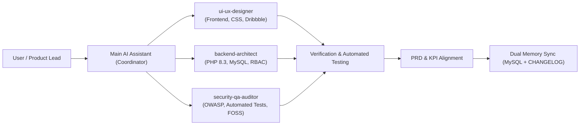

# 🤖 Antigravity Multi-Agent Squad & Specialized Roles
## PT Nihon Plast Indonesia - Corporate CMS Engineering Team

Untuk memastikan pengembangan sistem tetap terarah (*focused on goals*), berkualitas tinggi, dan terhindar dari *scope creep*, proyek ini didukung oleh tim agen cerdas (*AI Subagents*) yang memiliki spesialisasi peran masing-masing:

---

### 1. Daftar Agen Spesialis

| Nama Agen | File Definisi | Peran & Spesialisasi | Tools yang Diberikan |
| :--- | :--- | :--- | :--- |
| **`ui-ux-designer`** | [`docs/agents/ui-ux-designer.md`](file:///C:/Devaron/www/cms-compro/docs/agents/ui-ux-designer.md) | **Senior UI/UX Designer & Modern Frontend Specialist**<br>Desain otomotif Dribbble-grade, estetika Monozukuri, responsivitas layar tanpa patah (*strict no-wrap*), Swiper 11, kanvas partikel, dan CSS micro-interactions. | Write Tools, Shell CLI, MCP Tools |
| **`backend-architect`** | [`docs/agents/backend-architect.md`](file:///C:/Devaron/www/cms-compro/docs/agents/backend-architect.md) | **Principal Backend & Database Architect**<br>Logika server PHP 8.3 Native, skema & indeks komposit MySQL 8.0, helper CMS dinamis (`sec_val`, `sec_items`), otorisasi multi-user RBAC, dan translasi 5 bahasa i18n. | Write Tools, Shell CLI, MCP Tools (MySQL Query, Filesystem) |
| **`security-qa-auditor`** | [`docs/agents/security-qa-auditor.md`](file:///C:/Devaron/www/cms-compro/docs/agents/security-qa-auditor.md) | **Lead Security & Quality Assurance (QA) Auditor**<br>Audit keamanan OWASP Top 10 (SQLi, XSS, CSRF), verifikasi header proteksi `.htaccess`, pengujian unit otomatis 26 skenario, dan kepatuhan lisensi 100% FOSS. | Write Tools, Shell CLI, MCP Tools |

---

### 2. Cara Memanggil Agen Spesialis

Agen spesialis dapat dipanggil kapan saja oleh agen utama menggunakan tool `invoke_subagent` dengan format:

```json
{
  "Subagents": [
    {
      "TypeName": "ui-ux-designer",
      "Role": "UI/UX Designer",
      "Prompt": "Audit responsivitas halaman products.php pada resolusi mobile 375px dan pastikan modal spesifikasi teknik tertata rapi."
    }
  ]
}
```

Atau untuk kolaborasi paralel lintas domain:
```json
{
  "Subagents": [
    {
      "TypeName": "backend-architect",
      "Role": "Backend Developer",
      "Prompt": "Buat endpoint API dan helper untuk filtering produk berdasarkan resin material."
    },
    {
      "TypeName": "security-qa-auditor",
      "Role": "Security Auditor",
      "Prompt": "Jalankan pengujian unit automated test script dan pastikan kueri baru terlindungi prepared statement."
    }
  ]
}
```

---

### 3. Matriks Alur Kerja Kolaboratif


